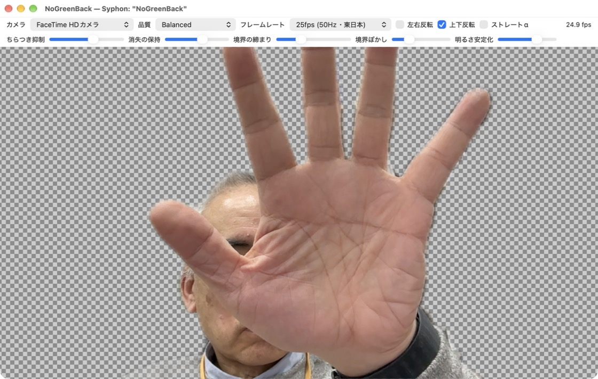

# NoGreenBack

[日本語](README.md) | English

NoGreenBack is a macOS app that cuts the person out of a webcam image in real time, with no green screen. It can put the person over your screen, composite a background and show the result full screen, and record the screen, with drawings, a keyboard, a pointer and live subtitles on top. The cut-out person can also be sent with a transparent background to other apps such as OBS, Resolume and MadMapper over Syphon.



- Person cut-out: Apple Vision person segmentation (`VNGeneratePersonSegmentationRequest`)
- Compositing: Core Image
- Output: Metal texture → `SyphonMetalServer` (server name `NoGreenBack`)

The app follows your Mac's language: English on an English (or other non-Japanese) system, Japanese on a Japanese system.

## Install

Runs on Apple Silicon Macs with macOS 12 or later.

1. Download `NoGreenBack.zip` from [Releases](https://github.com/kamemamo/nogreenback/releases), open it, and move `NoGreenBack.app` to the Applications folder.
2. Release builds are signed with Developer ID and notarized by Apple, so just double-click to open.
3. Allow camera access when asked.

## Build

Requirements: Apple Silicon Mac, Xcode, Metal Toolchain (`xcodebuild -downloadComponent MetalToolchain`)

```bash
./build.sh          # build NoGreenBack.app
./build.sh --zip    # also make dist/NoGreenBack.zip for other Macs
                    # (signed with Developer ID and notarized if the certificate and
                    #  a notarytool profile named "NoGreenBack" are set up)
open NoGreenBack.app
```

The first build clones Syphon-Framework into `vendor/` and builds it. To support Intel Macs, add `x86_64` to `ARCHS` in `build.sh`.

## The window

- **Toolbar**: only what you use while presenting — Person, Full Screen, PiP, Subtitles (and the subtitle settings button), Draw, Pen Lock, Whiteboard, Clear, Keyboard, Pointer, ATEM inputs, ● Record, the frame rate, and ? (shortcuts and tips). Toggles are colored while on (red while recording).
- **Left**: preview (transparent areas show a checkerboard).
- **Right sidebar**: settings grouped by Camera, Cut-out Tuning, Person Position and Size, Background and Full-Screen Output, Draw, Keyboard, Recording, External Audio and ATEM Switcher.
- **Shortcuts**: the ? button, Help > Keyboard Shortcuts, or ⌘/.

## Receiving in OBS

Add a "Syphon Client" source, choose `NoGreenBack`, and **check "Allow Transparency"** (otherwise the background is black).

## Overlaying on your screen without OBS

Turn on **PiP** to show the cut-out person in a corner of the screen, always on top. The background is transparent and clicks go through to the apps behind. Share your entire screen in Zoom or Teams and others see you over it (window sharing doesn't include it).

| Setting | Description |
|---|---|
| Person (toolbar) | Shows or hides the person everywhere (full-screen output, preview, Syphon, on-screen overlay) (⌃⌥⌘ P) |
| PiP (toolbar) | Shows the person in a corner of the desktop. "Person" is the master switch (off hides the person from PiP, full screen, preview and Syphon); "PiP" only turns the desktop overlay on or off |
| Position | Bottom right / bottom left / top right / top left |
| Size | Relative to the screen width (15–80%) |
| Display screen | Which screen to show it on |

Closing the NoGreenBack window removes the overlay and quits the app.

### Background and full-screen output

Put video from a USB capture device (such as slides from another PC), or this Mac's own screen, behind the person, and show the result full screen.

| Setting | Description |
|---|---|
| Background | Video behind the person. "None (transparent)" keeps it transparent. "Screen: …" uses this Mac's screen (NoGreenBack's own overlay and output aren't captured, so there's no feedback loop; needs Screen Recording permission the first time) |
| Full Screen (toolbar) | Shows the composited video filling the output screen (Esc or ⌃⌥⌘ F closes) |
| Output screen | Projector or external monitor |
| Aspect ratio | "Match output screen" avoids black bars when shown full screen |

- Drawings made on the full-screen output also go into the composited video (preview, and Syphon when there's a background).
- With no camera connected (or while the camera has stopped), the background, subtitles and drawings are still shown, without the person.
- To record the full-screen output, set "Screen to record" to the output screen.

### Drawing

Turn on **Draw** to draw on the screen.

- **Hold the draw key (⌥ Option by default)** and drag to draw. A colored frame shows while the key is held. Release it and clicks go to the apps behind.
- **Clear all**: press the draw key twice quickly, right-click while holding it, or press Clear (⌃⌥⌘ C).
- Choose color, width, and whether lines fade after 3 or 10 seconds.
- While **Full Screen** is on, you can draw only on the output screen and the screen being recorded. Other screens, such as the one with the control window, stay usable with the mouse even while you hold the draw key or Pen Lock is on. Turning off Full Screen also turns off Pen Lock.
- Works on every connected screen, including pen displays. **Pen Lock** (⌃⌥⌘ D) lets you draw without holding a key.
- **Whiteboard** (⌃⌥⌘ W): turn on Whiteboard to lay a translucent white board behind your drawings so they're easier to see. While Full Screen is on, it appears only on the full-screen output (the screen you record): the board goes into the composited video (so it's also in the preview, and in Syphon when there's a background) and isn't shown on other screens, such as the one with the control window. When Full Screen is off, it covers the display screen. The person stays in front of the board, with subtitles, the keyboard and drawings in front of that. Clicks go through the board to the apps behind. Change how white it is with "Board opacity". Turning off Draw also turns off the whiteboard.

### Keyboard

When explaining shortcuts (for Blender, for example), show a keyboard and circle keys on it with drawing.

- **JIS or US layout** with a numeric keypad (Sidebar > Keyboard > Layout). Where Mac and Windows key names differ, both are shown (white for Mac, light blue for Windows, e.g. ⌘ command / Alt).
- Shift characters are shown on the number and symbol keys.
- Toggle with **Keyboard** or ⌃⌥⌘ B. It goes into the composited video (preview, full-screen output, and Syphon with a background), so you can show it over another computer's screen brought in through an ATEM. When the full-screen output isn't covering the display screen, it's also shown directly on screen (and recorded).
- By default it sits in the gap between the person and the edge of the screen ("Opposite the person"). You can also choose bottom center, bottom left, bottom right or top center, and the size.

### Pointer

Turn on **Pointer** (⌃⌥⌘ L) to point at the mouse position with a pointer stick and a white arrow. The mouse cursor is hidden while it's on, and the arrow tip takes its place.

- The stick has a fixed length and always comes from the lower right of the arrow. It tilts a little more toward the left of the screen and follows smoothly. Near the bottom and right edges it turns to stay on screen, always staying to the lower right of the arrow (it never swings up or to the left). In the lower-right corner, part of the stick simply goes off screen (the tip still points where you want).
- It's drawn directly on screen (and recorded). Over the full-screen output it's drawn inside the composited video, so you can point at another computer's screen too.

### Screen recording

**● Record** records the "Screen to record" and saves `NoGreenBack date time.mp4` to your Movies folder.

- The overlaid person and drawings are recorded; the NoGreenBack control window isn't.
- A small "■ Stop Recording" button with the elapsed time appears at the top right of the screen being recorded, so you can tell which screen is recorded (it isn't recorded itself). Stop with it or ⌃⌥⌘ R.
- When recording the same screen as the control window, the window goes to the Dock while recording and comes back when you stop.
- Like OBS's Hybrid MP4, recordings survive crashes and power loss: the app writes `.mov` fragments every 2 seconds and converts to `.mp4` without re-encoding when you stop.
- Quality settings: video 4–40 Mbps, long side 1280 / 1920 / 2560 / 3840 / Original, 24–60 fps, H.264 or HEVC, audio 64–256 kbps. An estimate of the size per hour is shown.
- Choose the microphone in "Microphone" ("None" for no audio). Screen Recording and Microphone permissions are needed the first time.
- Requires macOS 12.3 or later.

### External audio

Bring in audio from a capture card or audio interface, play it on a speaker, and mix it with your microphone when recording.

- **Input**: the device to bring in. **Speaker**: where to play it. **Volume**: affects both.
- **Duck for voice** lowers the external audio in the recording while you speak.

### ATEM switcher

Switch inputs on a Blackmagic Design ATEM switcher (ATEM Mini and others) from the toolbar, over USB.

- Plug in an ATEM over USB and it connects automatically: an "ATEM Switcher" section appears in the sidebar, and input buttons and a **Mix** checkbox appear in the toolbar. Unplug it and they go away. If it's plugged in at launch, it connects right away.
- Controlling it over USB needs Blackmagic ATEM Software Control installed on that Mac (the sidebar tells you if it's missing).
- The button you press goes to program; changes made on the ATEM are reflected too.
- With **Mix** on, inputs change with a 0.5-second mix; off cuts immediately.
- macOS may ask for Local Network permission the first time (a USB-connected ATEM appears to the Mac as a network device). Allow it.

### Subtitles

Turn on **Subtitles** (⌃⌥⌘ S) to turn your speech into subtitles on your Mac (audio isn't sent anywhere).

- **Language**: Japanese or English, chosen with the button next to Subtitles. By default it follows the app's language.
- Subtitles appear at the bottom of the preview, full-screen output, Syphon and the display screen — in the gap opposite the person when the person is shown, and above the keyboard when it's shown.
- **Fix mishearings with AI** (Apple Intelligence; macOS 26 or later with Apple Intelligence on): after each sentence, the on-device AI rereads it and fixes misrecognized words and technical terms, then updates the subtitle on screen and in the subtitle file. Nothing is sent over the internet. Corrections that would change key names, letters or numbers are discarded. Turn it on or off with the button next to Subtitles (on by default where available).
- **Replacements**: write often-misheard words one per line as `wrong → right` (`->` or `=` also work) and they're fixed everywhere. Save and load the list as a file.
- **When recording**, subtitles aren't burned into the picture. They're saved as a subtitle track inside the .mp4 and as a .srt file with the same name. When you record the full-screen output, the subtitles in it are recorded.
- Works best on macOS 26 or later (earlier versions need Dictation turned on). The first time, recognition data for the language is downloaded and Microphone and Speech Recognition permissions are needed.

### Using a single screen

With one monitor (a MacBook on its own, for example), don't use Full Screen; overlay everything directly on your screen.

- **Person**: turn on PiP to show the person in a corner of the screen.
- **Drawing**: turn on Draw and Whiteboard. The board covers the whole screen, with the person in front of it and your drawings in front of that. Clicks go through the board, so you can keep using your slides and other apps.
- **Recording**: leave "Screen to record" as "Same as display screen". The board, person, keyboard and drawings are all recorded (subtitles are saved separately as a .srt file).
- **Zoom or Teams**: share your entire screen and others see the same view.

Notes:

- On a single screen, Full Screen covers everything, including the menu bar and Dock, and takes your clicks, so you can't use the apps behind it (close it with Esc or ⌃⌥⌘ F). Full Screen is for sending the video to a second screen, such as a projector or an external monitor.
- The NoGreenBack window also ends up under the translucent board. You can still click it, but it looks faded. While recording, the window goes to the Dock and comes back when you stop.

### Shortcuts (for Stream Deck)

These work even while other apps are in front. In Stream Deck, assign them to a Hotkey action.

| Shortcut | Action |
|---|---|
| ⌃⌥⌘ R | Start or stop recording |
| ⌃⌥⌘ P | Show or hide the person |
| ⌃⌥⌘ C | Clear all drawings |
| ⌃⌥⌘ D | Pen (drawing mode) on or off |
| ⌃⌥⌘ K | Next pen color |
| ⌃⌥⌘ F | Show or hide full-screen output |
| ⌃⌥⌘ S | Subtitles on or off |
| ⌃⌥⌘ B | Show or hide the keyboard |
| ⌃⌥⌘ L | Pointer on or off |
| ⌃⌥⌘ W | Show or hide the whiteboard |

If another app already uses a combination, it can't be registered and you'll be told at launch.

## Settings

| Setting | Description |
|---|---|
| Quality | Fast / Balanced / Accurate. Accurate gives cleaner edges with more load |
| Mirror / Flip | Image orientation (both on by default). Remembered for next time |
| Straight α | Off: premultiplied alpha / On: straight alpha. Switch if edges look dark or light. Remembered |
| Frame rate | 30fps (60Hz) / 25fps (50Hz, default) / 20fps. Match your lights' power frequency to reduce flicker |
| Brightness stabilization | Smooths whole-frame flicker from lighting |
| Flicker reduction (Cut-out Tuning) | Smooths the mask over time where there's little motion |
| Hold on dropout | Fades out slowly instead of vanishing when detection briefly fails |
| Edge tightening | Reduces semi-transparent edges |
| Edge softness | Softens the mask edge |

## License

- NoGreenBack: [MIT License](LICENSE)
- The bundled [Syphon Framework](https://github.com/Syphon/Syphon-Framework) is under the BSD license. Its notice is in [THIRD_PARTY_NOTICES.md](THIRD_PARTY_NOTICES.md) and inside the app (`NoGreenBack.app/Contents/Resources/`).
