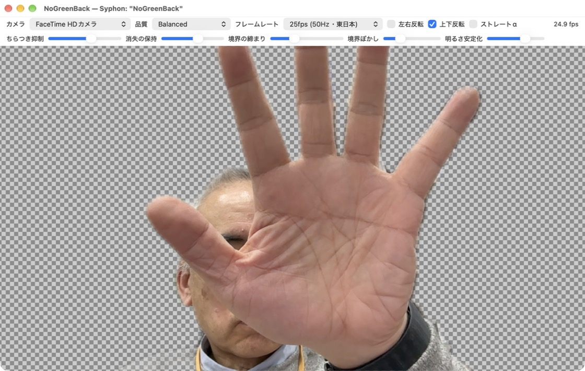

# NoGreenBack

Webカメラ映像から人物だけをリアルタイムで切り抜き（背景は透明）、Syphon で他のアプリ（OBS、Resolume、MadMapper など）へ送る macOS アプリです。



- 人物の切り抜き: Apple Vision の人物セグメンテーション（`VNGeneratePersonSegmentationRequest`）
- 合成: Core Image
- 送出: Metal テクスチャ → `SyphonMetalServer`（サーバー名 `NoGreenBack`）

## ビルド

必要なもの: Apple Silicon Mac、Xcode、Metal Toolchain（`xcodebuild -downloadComponent MetalToolchain`）

```bash
./build.sh
open NoGreenBack.app
```

`build.sh` は初回に Syphon-Framework を `vendor/` へ clone してビルドし、`NoGreenBack.app` を作ります。

## 他の Mac で使う

Apple Silicon の Mac（macOS 12 以降）で動きます。Intel Mac にも対応させたい場合は、`build.sh` の `ARCHS` に `x86_64` を足してビルドし直します。他の Mac には Xcode は不要です。

1. この Mac で配布用 zip を作ります。

   ```bash
   ./build.sh --zip
   ```

2. `dist/NoGreenBack.zip` を AirDrop や USB などで他の Mac にコピーして展開し、`NoGreenBack.app` を「アプリケーション」フォルダに入れます。
3. 初回だけ起動の許可が必要です（Apple の公証を受けていないため）。次のどちらかで許可します。
   - ターミナルで次を実行してから、普通に開く

     ```bash
     xattr -dr com.apple.quarantine /Applications/NoGreenBack.app
     ```

   - 一度開こうとしてブロックされたあと、「システム設定 > プライバシーとセキュリティ」の下の方にある「このまま開く」を押す
4. 起動したらカメラへのアクセスを許可します。

## OBS での受信

ソースに「Syphon クライアント」を追加し、プロパティで `NoGreenBack` を選んで **「透過を許可」にチェック**を入れます（入れないと背景が黒になります）。

## OBS を使わずに画面に重ねる

「画面に表示」にチェックを入れると、切り抜いた人物を画面の隅に常に手前で表示します。背景は透明で、人物の上をクリックしても後ろのアプリを操作できます。Zoom や Teams で「画面全体」を共有すれば、相手にも人物が重なった画面が見えます（ウィンドウ単位の共有では映りません）。

| 項目 | 内容 |
|---|---|
| 画面に表示 | 人物を画面に重ねて表示します。背景映像を使っているときは、全画面出力などに入れる人物もこれで出し入れします（⌃⌥⌘ P） |
| 位置 | 右下 / 左下 / 右上 / 左上。人物の下端が画面の下にそろいます |
| 大きさ | 画面の幅に対する割合（15〜80%） |
| 表示する画面 | プロジェクターや外部モニターをつないでいるときに、表示先を選びます |

NoGreenBack のウィンドウを閉じると、重ねた表示も消えてアプリが終了します。

### 背景映像と全画面出力（OBS を使わずに合成する）

USB キャプチャーなどで取り込んだ映像（別の PC のスライドなど）を人物の後ろに敷き、そのまま画面いっぱいに出せます。

| 項目 | 内容 |
|---|---|
| 背景映像 | 人物の後ろに敷く映像。「なし（透明）」にすると今までどおり背景は透明です。背景映像は画面いっぱいに広げ（はみ出した部分は切ります）、人物は「位置」「大きさ」に合わせて隅に小さく入ります |
| 全画面で出す | 合成した映像を「出す画面」いっぱいに表示します（縦横比は保ち、余白は黒）。Esc か ⌃⌥⌘ F で閉じます |
| 出す画面 | プロジェクターや外部モニターを選びます。初めはメイン以外の画面が選ばれます |

- 背景を選ぶと、プレビュー、Syphon、画面に重ねる表示も背景入りになります。
- 全画面出力を「表示する画面」と同じ画面に出している間は、人物は出力の中に入るので、画面に重ねる表示は自動で隠れます。手書きの注釈は全画面出力の上に描けます。
- 全画面出力を録画するときは、「録画する画面」を「出す画面」と同じ画面にします。
- キャプチャーの音声を録画に入れるときは、「マイク」でキャプチャーの音声入力を選びます。

### 手書きの注釈

「手書き」にチェックを入れると、画面にペンで書き込めます（人物の表示よりさらに手前に描かれます）。

- **描くキー（既定は ⌥ Option）を押している間だけ**、ドラッグで線が描けます。押している間は画面の縁に色の枠が出ます。
- キーを離せば、クリックは後ろのアプリに届くので、スライド送りなどの操作がそのままできます。
- **全部消す**: 描くキーを素早く 2 回押す（描かずに離す）。キーを押しながら右クリック、メイン画面の「消去」ボタンでも消せます。
- 色・太さ・「3秒で消す／10秒で消す」を選べます。
- つながっているすべての画面に書き込めます。液晶タブレットのように別の画面として認識される機器でも、ペンでそのまま描けます。手元にキーボードがないときは、⌃⌥⌘ D でペンをオンにしておくと（Stream Deck やタブレットのボタンに割り当てるのが便利）キーを押さずに描けます。

キーを押している間は、そのキーを使ったクリック（⌥ クリックなど）は後ろのアプリに届きません。

### 画面録画

「● 録画開始」で「録画する画面」（6 段目。既定は「表示する画面と同じ」。液晶タブレットなど別の画面も選べます）を録画し、もう一度押すと止めて「ムービー」フォルダに `NoGreenBack 日付 時刻.mp4` で保存します（保存後に Finder で表示）。

- 重ねた人物と手書きの注釈も録画されます。NoGreenBack の操作ウィンドウは映りません。
- OBS の「Hybrid MP4」と同じように、録画中にアプリが落ちたり電源が切れたりしても消えません。録画中は 2 秒ごとに区切って `.mov` に書き込み、止めたときに再圧縮せずに `.mp4` へ詰め替えます（長い録画では「保存中…」が少し出ます）。落ちたときは `.mov` が残り、そのまま再生できます。
- 画質は 6 段目の「録画の設定」で数値で選べます（既定は 8 Mbps・長辺 1920・30 fps・H.264・音声 128 kbps）。右に「1 時間で最大 約 ○ GB」の目安が出ます。

  | 項目 | 選べる値 |
  |---|---|
  | 映像 | 4 / 6 / 8 / 10 / 12 / 16 / 20 / 30 / 40 Mbps（平均ビットレート。動きの少ない画面では実際はもっと小さくなります） |
  | 長辺 | 1280 / 1920 / 2560 / 3840 / 縮めない（画面のほうが小さいときは画面のまま。1920 で 1080p 相当） |
  | フレームレート | 24 / 25 / 30 / 50 / 60 fps（最大値。画面が動かない間はコマ数が減ります） |
  | 形式 | H.264 / HEVC (H.265)。HEVC は同じ画質でファイルが約半分ですが、古い Mac や一部の編集ソフトでは開けないことがあります |
  | 音声 | 64 / 96 / 128 / 192 / 256 kbps（AAC・48kHz・モノラル） |

- 圧縮は Mac の専用回路で行うので、録画しても重くなりにくくなっています。設定は次の録画から使われます。
- 「マイク」で録画に入れるマイクを選びます（「なし」で音声なし）。USB マイクやオーディオインターフェースをつなぐと一覧に追加されます。右のメーターで入力レベルを確かめられます（話したときに緑〜黄色まで振れればちょうどよい音量）。マイクを選んでいる間は録画していなくてもマイクを開くので、メニューバーにマイク使用中の印が出ます。
- 初回は「画面収録」と「マイク」の許可が必要です。画面収録は、許可したあとアプリを開き直すと有効になります。ビルドし直しても許可は引き継がれます。1.4 以前に許可した Mac で録画できないときは、`tccutil reset ScreenCapture local.nogreenback` を実行してから許可し直してください。
- macOS 12.3 以降で使えます。

### ショートカット（Stream Deck から使う）

他のアプリが前面にあっても効くショートカットです。Stream Deck では、ボタンに「ホットキー」アクションを置いて、このキーの組み合わせを設定します。

| ショートカット | 動作 |
|---|---|
| ⌃⌥⌘ R | 録画の開始・停止 |
| ⌃⌥⌘ P | 人物を画面に表示・非表示 |
| ⌃⌥⌘ C | 手書きを全部消す |
| ⌃⌥⌘ D | ペン（描画モード）のオン・オフ。オンの間はキーを押さなくても描けます |
| ⌃⌥⌘ K | ペンの色を次の色へ |
| ⌃⌥⌘ F | 全画面出力の表示・非表示 |

ペンをオンにしている間は、クリックが後ろのアプリに届きません。操作に戻るときは、もう一度 ⌃⌥⌘ D を押します。他のアプリが同じ組み合わせを使っていると登録できず、起動時にお知らせが出ます。

## 設定項目

| 項目 | 内容 |
|---|---|
| 品質 | Fast / Balanced / Accurate。Accurate ほど境界が正確で、負荷は高くなります |
| 左右反転 / 上下反転 | 映像の向き |
| ストレートα | オフ: プリマルチプライドα / オン: ストレートα。縁が黒や白に見えるときに切り替えます |
| フレームレート | 30fps (60Hz・西日本) / 25fps (50Hz・東日本、既定) / 20fps。照明の電源周波数に合わせるとフリッカーが出にくくなります。選んだ値は次回起動時も使われます |
| 明るさ安定化 | 照明のフリッカーによる画面全体の明滅をならします（横じまは消せません） |
| ちらつき抑制 | 動きの少ない部分のマスクを時間方向に平滑化します |
| 消失の保持 | 人物判定が急に外れても、すぐ消さずにゆっくりフェードさせます（手を顔の前にかざしたときなど） |
| 境界の締まり | 半透明の縁を減らしてくっきりさせます |
| 境界ぼかし | マスクの境界をぼかします |

## 確認ツール

`Tools/syphon-check.swift` は Syphon サーバー一覧を表示し、NoGreenBack から 1 フレーム受信して PNG に保存します。

```bash
swiftc -F vendor/build -framework Syphon -Xlinker -rpath -Xlinker "$PWD/vendor/build" Tools/syphon-check.swift -o vendor/syphon-check
./vendor/syphon-check frame.png
```
